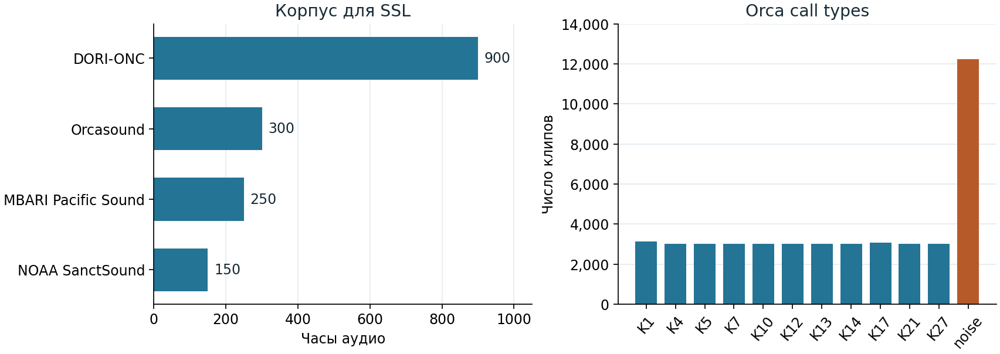
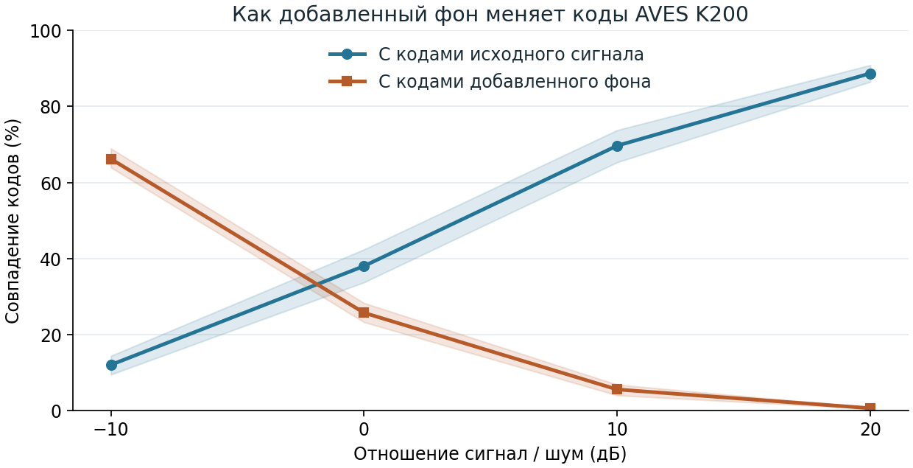

# EDA: редкие сигналы в подводных записях

Проверил, из чего состоит корпус, хватает ли разметки для оценки на новых
записях и насколько представление сигнала меняется при добавлении фона.

## Состав и качество данных

| Набор | Проверенный объём | Для чего используем |
| --- | --- | --- |
| SSL: DORI-ONC, Orcasound, MBARI Pacific Sound, NOAA SanctSound | 1 600 ч, 1 152 000 окон по 5 с. WAV 16 кГц, mono, PCM16 в TAR | Доменное дообучение без экспертных меток |
| Orca call types (закрытый) | 45 429 WAV, 11,15 ч. Из них 12 228 клипов `noise`, остальные — 11 K-типов | Классификация типов и проверка «сигнал / шум» |
| Avacha-Gulf (закрытый) | 17 полевых WAV, 1,22 ч, 613 размеченных событий | Проверка детекции в непрерывном аудио |
| Orcasound Hackathon | 4 295 читаемых файлов, 70,75 ч | Детекция присутствия косаток |
| DORI ONC-Benchmark | 385 размеченных FLAC, 32,08 ч | Внешняя проверка детекции |
| BEANS Watkins | 1 697 исходных WAV, 4,92 ч; 1 695 клипов и 31 вид после фильтра BEANS | Дополнительная классификация видов |

Открытые источники: [DORI-ONC](https://www.oceannetworks.ca/),
[Orcasound](https://www.orcasound.net/),
[MBARI Pacific Sound](https://www.mbari.org/project/pacific-sound/),
[NOAA SanctSound](https://sanctsound.ioos.us/) и
[BEANS](https://github.com/earthspecies/beans).

[Данные для графиков](plot_data.csv).

Больше половины SSL-аудио приходится на DORI-ONC (900 ч). Отдельные K-типы
близки по числу клипов, а на `noise` приходится 26,9% коллекции.
Эта доля отражает сборку размеченного набора и ничего не говорит о доле
фона в море. У K27 нет примеров в validation в текущем разбиении.

Проверки декодирования и соответствия разметке выявили один пустой FLAC
в публикации Orcasound и одну строку без аудио в ONC-Benchmark. В Orca
call types есть точные дубликаты. При случайном разбиении по клипам
связанные примеры могут попасть в разные части; нужны группы сессий.
Частоты исходного аудио различаются, поэтому полосу и ресемплинг фиксируем
вместе с параметрами модели.

## Сколько сигнала видно в непрерывных записях

Просмотрены спектрограммы 120 случайных окон, по 30 на источник.
После взвешивания по размеру источника явные кандидаты есть в **15,5% окон**,
но отмеченные участки занимают только **3,7% времени**. Если включить
спорные участки, получится 5,8% времени. Это визуальный аудит,
а не экспертная разметка. Неотмеченные окна могут содержать тихие сигналы.
Срабатывания OrcaHello и Google Whale не использовали как оценку доли:
первый чувствителен к постоянному смещению, второй пропускает контроли.

## Что SSL-энкодер узнаёт о фоне

По гистограмме 200 кодов AVES источник записи различим с balanced
accuracy **87,7%** (случайный уровень — 25%). При этом 23 кода,
обогащённые в `noise`-клипах, занимают 27,7% кадров клипов с
вокализациями. Удалять эти ID как «шумовые» было бы рискованно.

В контролируемом опыте 12 размеченных сигналов смешали с 12 контекстами
на четырёх уровнях SNR. При −10 дБ код смеси совпадал с кодом фона
в **66,2%** кадров и с кодом исходного сигнала в **12,0%**. При +20 дБ
совпадение с сигналом выросло до **88,7%**. Это эффект в выбранном
кодбуке и смесях, а не оценка ошибок полевой детекции.
Полосы на графике — 95%-е bootstrap-интервалы по 12 сигналам.

## Что получилось при обычном дообучении

Замороженные исходные энкодеры и версии после доменного дообучения
сравнили с одинаковым downstream-протоколом. Ниже macro-F1 в процентах.

| Задача | HuBERT | HuBERT + дообучение | AVES | AVES + дообучение |
| --- | ---: | ---: | ---: | ---: |
| Orca call types, 11 типов | 89,2 | 79,2 | 89,5 | 87,1 |
| Watkins, 31 вид | 81,9 | 87,0 | 92,0 | 91,2 |

Больше морского аудио само по себе не улучшило основную задачу.
На Orca call types тест охватывает только две группы источников,
поэтому результат пока нельзя переносить на новые условия записи.
Следующий эксперимент — проверить отбор обучающих окон и устойчивость
SSL-целей к смене фона, сохранив обычное дообучение как контроль.

В отдельном скрининге без доступа к отложенному тесту у готовых
энкодеров получился macro-F1 87,1% (AVES), 90,5% (EAT) и 94,6%
(BEATs) на групповой кросс-валидации Orca call types. Эти числа
посчитаны по другому разбиению и не сравниваются напрямую с таблицей.

Источник чисел — инвентаризация аудио, аудит AVES K200, шумовой
эксперимент и итоговый отчёт по доменному дообучению. В репозиторий
вынесены только агрегаты.
