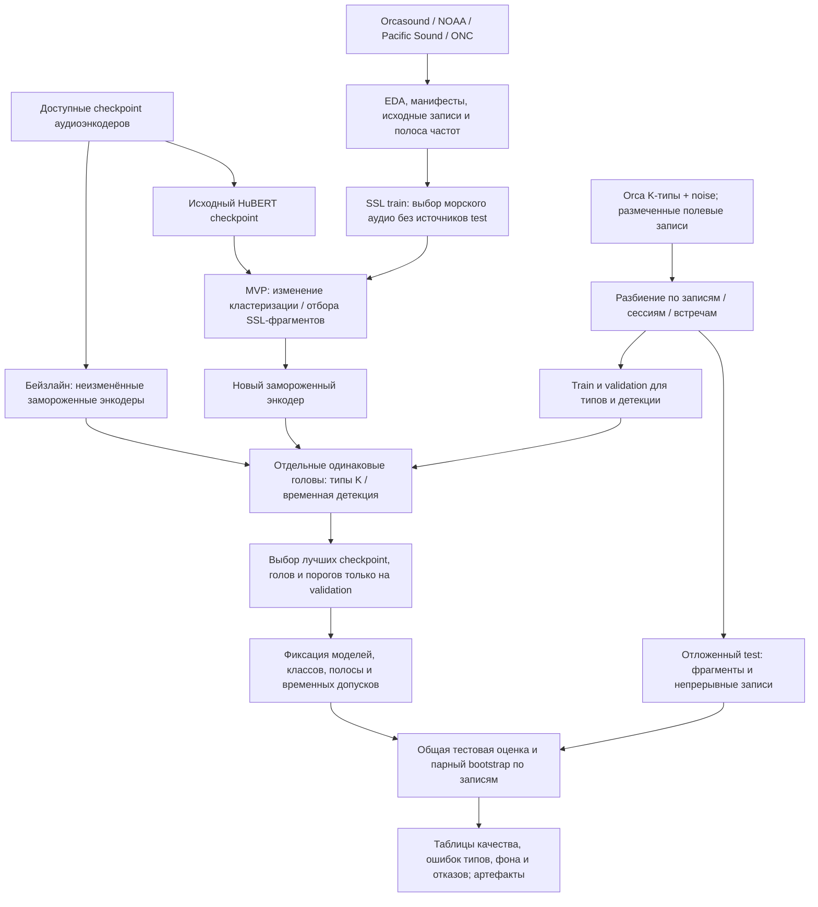
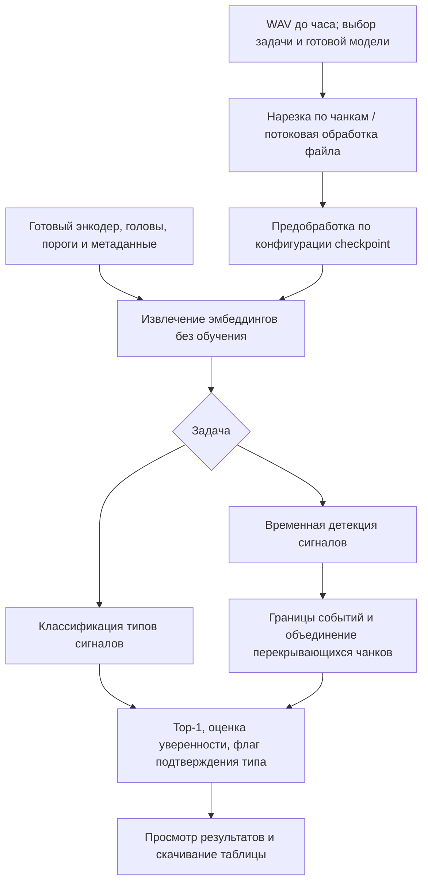

# Дизайн ML-системы MLSD_ITMO

**Self-Supervised Representation Learning for Rare Events in Continuous Signals**

Рабочая версия разделов 1.1–2.2: цели, требования и план исследования.
Новые эксперименты этой итерации ещё не проведены. Структура основана на
[шаблоне Reliable ML](https://github.com/IrinaGoloshchapova/ml_system_design_doc_ru/blob/main/ML_System_Design_Doc_Template.md).

## 1. Цели и предпосылки

### 1.1. Зачем идём в разработку продукта?

Проект — часть ВКР, курсовой работы и исследования лаборатории.
Прикладная задача согласована с внешним исследователем акустики косаток.
Пользователи — учёные, которым нужны обнаружение сигналов в непрерывных
пассивных акустических записях и классификация их типов.

Экспертная разметка трудоёмка, специалистов мало, а в записях преобладает фон.
Предварительная оценка доли полезных событий — 1–5% времени; её проверим при EDA.
Цель — обучить SSL-энкодер для редких сигналов морских млекопитающих
и использовать его представления при ограниченной downstream-разметке.
Гипотеза: изменение кластеризации, отбора фрагментов или SSL-обучения
уменьшит преобладание фоновых представлений.

Экспериментальная база — подготовленный командой MarineMammalBench.
Он показывает зависимость качества от задачи и проблемы переноса с выделенных
сигналов на полевые записи; причинная роль фоновых данных ещё требует проверки.

Минимальный научный результат — воспроизводимое статистически значимое улучшение
относительно исходного HuBERT-контроля. Внешнее сравнение проводится с сильнейшим
доступным checkpoint для каждой задачи; желаемая цель — превзойти сильные модели
по большинству выбранных задач. Пользовательский результат — веб-прототип,
помогающий анализировать записи и проверять предсказания.
Сокращение времени ручной работы предстоит измерить.

### 1.2. Бизнес-требования и ограничения

| Требование | Планируемое поведение |
| --- | --- |
| Классификация | Наиболее вероятный известный тип сигнала и оценка уверенности. |
| Обнаружение | События в непрерывном аудио: временные границы, предполагаемые типы и оценки уверенности. |
| Неуверенный ответ | Тип помечается как неподтверждённый; top-1 и его оценка остаются видимыми. |
| Вход и обработка | Один или несколько WAV, включая часовые записи; обработка по чанкам батчами или потоково. |
| Интерфейс | Загрузка, выбор задачи и готовой модели, просмотр и табличный экспорт результатов. |
| Развёртывание | Открытый код, самостоятельный локальный или серверный запуск; обучение выполняется отдельно от интерфейса. |

Приоритет ошибок по убыванию нежелательности: неверный тип сигнала,
ложное срабатывание на фоне, пропуск. Численные требования к точности,
допустимым ложным срабатываниям и доле неподтверждённых ответов уточняются с заказчиком.

Для обучения доступен кластер с несколькими NVIDIA A100.
Инференс должен умеренно потреблять видеопамять и обрабатывать файл по частям.
Лимит памяти, возможность CPU-инференса и приемлемое время обработки определим
после замеров бейзлайна. Место нарезки — клиент или сервер — пока не выбрано.

Orca call types — закрытый набор, доступный для использования в проекте
по сведениям участника. Сами записи и закрытые ссылки не входят в публичную
поставку. Лицензия открытого кода ещё не выбрана.

В пилоте исследователь загружает WAV, выбирает задачу, проверяет результаты
и выгружает таблицу. Окончательное решение о типе сигнала принимает эксперт.
Критерии пилота — качество на размеченных записях, воспроизводимость
и применимость результатов к работе исследователя; численные пороги
и пользовательская проверка согласуются до запуска пилота.

Ориентир основных научных результатов — конец 2026 года.
Срок веб-прототипа и требования следующих домашних работ пока не установлены.

### 1.3. Что входит в скоуп проекта/итерации, что не входит

Текущая HW1 включает репозиторий и дизайн-документ.
В последующую исследовательскую итерацию и планируемый MVP входят:

- EDA, проверка разметки, доли событий, классов и происхождения записей.
- Выбор морских данных и разработка SSL-метода на основе HuBERT;
  первые направления — кластеризация и отбор обучающих фрагментов.
- Проверка представлений на классификации и обнаружении по общему протоколу.
- Веб-прототип применения готовых моделей.

Контрастивное обучение, синтетические сигналы и дополнительные задачи
MarineMammalBench рассматриваются по результатам EDA.
Перенос на другие домены и обнаружение неизвестных типов — дополнительные
эксперименты. В первую версию не входят пользовательское обучение через интерфейс,
суточные файлы и промышленный многопользовательский сервис.

Для воспроизводимости сохраняются конфигурации, seed, split-манифесты,
списки классов, идентификаторы checkpoint, метрики и вычислительный бюджет.
Код проверяется Ruff, pre-commit и CI; данные и веса хранятся отдельно от Git.

Планируемый технический долг: веб-стек, лицензия, загрузка и хранение файлов,
место нарезки и оптимизация инференса. Эти решения будут уточняться
в следующих разделах документа.

### 1.4. Предпосылки решения

| Данные | Состояние и роль |
| --- | --- |
| Orca call types | Закрытый доступный набор: архивы 11 K-типов и noise. Начальная классификация; состав и происхождение фрагментов проверяются при EDA. |
| Avacha-Gulf | Отдельная коллекция для планируемой полевой оценки. Фактический доступ, состав и пригодность разметки уточняются. |
| Orcasound, NOAA/NCEI, Pacific Sound, ONC | Источники неразмеченного SSL-аудио доступны по сведениям участника. Объём первой обучающей выборки ещё не выбран. |
| Другие наборы MarineMammalBench | Кандидаты для дополнительных проверок; отбор по релевантности, качеству и независимости данных. |

Доступность источников не означает, что весь архив уже скачан и проверен.
Наборы отбираются по EDA, до получения итоговых тестовых результатов.

Единица входа — короткий аудиофрагмент; энкодер выдаёт последовательность
эмбеддингов. Классификация использует представление фрагмента,
детекция — временную последовательность. Окно, шаг и обработка каналов
выбираются экспериментально. Отдельно фиксируются исходная и модельная частоты
дискретизации, ресемплинг, сохраняемая полоса и временная сетка эмбеддингов.

Метки нужны для downstream-голов и оценки. Неразмеченность SSL-входа
не требует автоматически решать задачу неизвестных классов.
Доля фона, частоты типов и разнообразие фоновых условий пока не измерены.

Основные риски — ошибки разметки, редкие классы, перенос с коротких фрагментов
на полевые записи и утечки между связанными записями. Для оценки потребуются
групповые идентификаторы и независимо размеченное непрерывное аудио.

## 2. Методология

### 2.1. Постановка задачи

Обучаем энкодер f_theta: аудиофрагмент x преобразуется в эмбеддинги
z = f_theta(x). В основном сравнении энкодеры заморожены;
для каждого отдельно обучаются одинаковые по архитектуре и бюджету головы:
линейный классификатор типов и лёгкая временная голова детекции.

Цели классификации — известные типы сигналов; цели детекции — наличие,
границы и тип события, если это позволяет разметка.
Фон — звуки, не относящиеся к морским млекопитающим.
Отсутствие метки не считается доказательством отсутствия сигнала.

Бейзлайны — доступные checkpoint аудиоэнкодеров MarineMammalBench.
Для каждой задачи выбирается лучший по validation; неизменённый HuBERT
служит дополнительным контролем исследуемого изменения.
Исторические тестовые числа — ориентир; итоговое сравнение требует общего протокола.
Дополнительное доменное дообучение бейзлайнов пока не решено и, если проводится,
оценивается отдельным режимом.

План эксперимента:

1. Проверить аудио и метки; разделить данные по записям, сессиям или независимым
   встречам. Связанные чанки остаются вместе. Test-источники исключаются
   из нового SSL-обучения; неизвестное пересечение с предобучением внешних
   checkpoint указывается как ограничение.
2. Проверять изменения кластеризации и/или отбора SSL-фрагментов по отдельности,
   при сопоставимых данных и бюджете обучения.
3. Обучать головы на train. Выбирать checkpoint, представления, параметры голов
   и отдельные пороги детекции и подтверждения типа на validation
   с одинаковым бюджетом поиска.
4. Зафиксировать классы, конфигурации, первичные метрики и правила оценки
   до итогового test. Полное downstream-дообучение энкодеров — отдельный эксперимент.

| Проверка | Метрики |
| --- | --- |
| Типы сигналов | Macro-F1 на одинаковом фиксированном списке классов, precision/recall по типам и матрица ошибок; отдельный срез без фона. |
| Детекция | Event F1, precision и recall при одинаковых допусках границ и правилах извлечения событий. |
| Фон | Ложные срабатывания в час на независимо размеченных фоновых интервалах. |
| Неподтверждённые типы | Precision подтверждённых ответов, их доля и доля отказов; top-1 на всей тестовой выборке. |
| Стоимость | Время обработки часа WAV и пиковая память на указанном оборудовании; стоимость SSL отдельно. |

Для дополнительных задач сохраняются метрики соответствующего протокола
MarineMammalBench. Участие фона в macro-F1 фиксируется заранее.
Неподтверждённый тип не становится автоматически фоном и не удаляется из test;
в операционной оценке он не считается корректно классифицированным.

Статистическая проверка — парный bootstrap по независимым записям или группам,
95% доверительный интервал разницы метрик, несколько seed для лёгких голов.
Значимое улучшение предполагает положительную нижнюю границу интервала.
При одном SSL-запуске отдельно отмечается неоценённая вариативность предобучения.
Минимальный практически важный прирост и допустимые операционные ошибки
согласуются до итогового тестирования.

### 2.2. Блок-схема решения

Бейзлайн и MVP используют общий downstream-протокол; изменение находится
в SSL-обучении и полученном энкодере.

Планируемый веб-прототип применяет готовые модели. Место нарезки пока открыто.

Детальные этапы решения (2.3), подготовка пилота (3) и развёртывание (4)
будут описаны по результатам EDA и последующих итераций проекта.
