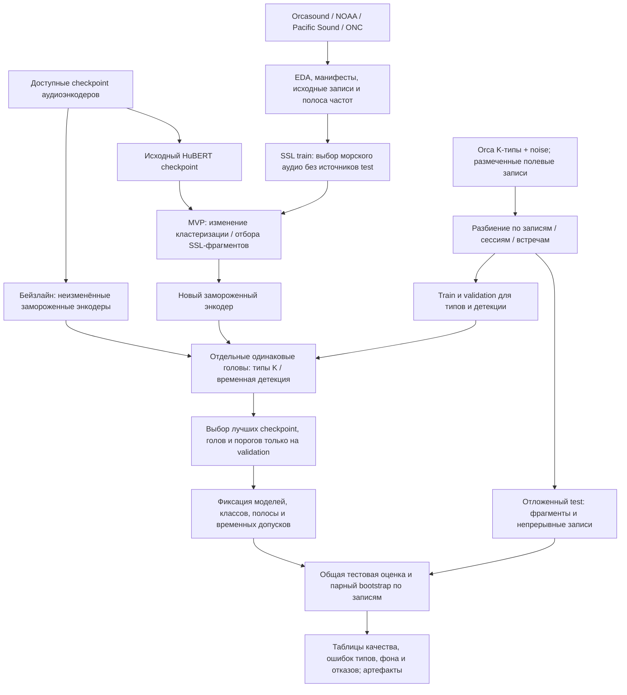
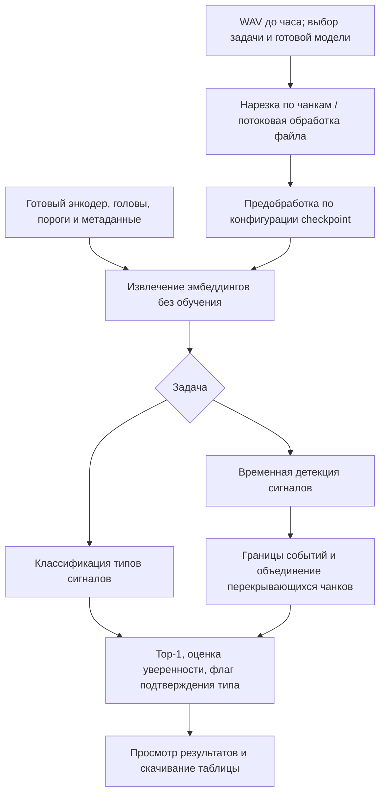

# Дизайн ML-системы MLSD_ITMO

**Self-Supervised Representation Learning for Rare Events in Continuous Signals**

Статус: проектирование первой исследовательской итерации. Документ описывает цели,
требования и предполагаемую методологию; новые эксперименты в рамках этой итерации
ещё не проведены. Структура основана на
[шаблоне Reliable ML](https://github.com/IrinaGoloshchapova/ml_system_design_doc_ru/blob/main/ML_System_Design_Doc_Template.md).

## 1. Цели и предпосылки

### 1.1. Зачем идём в разработку продукта?

Проект выполняется как часть ВКР, курсовой работы и исследования лаборатории.
Прикладная задача согласована с внешним исследователем акустики косаток.
Основные пользователи — учёные, анализирующие пассивные акустические записи
морских млекопитающих. Им нужны обнаружение сигналов в непрерывном аудио
и классификация их типов; приоритет между этими двумя задачами пока не установлен.

Экспертная разметка трудоёмка, а число специалистов ограничено. Непрерывные записи
содержат много фона: шум судов, антропогенные и другие звуки, не относящиеся
к морским млекопитающим. По предварительной оценке команды, полезные события могут
занимать порядка 1–5% времени. Фактическая доля и распределение классов будут
проверены при исследовательском анализе данных (EDA).

Цель — получить SSL-энкодер, который извлекает полезные представления таких событий
из неразмеченного аудио и позволяет обучать классификаторы и детекторы
на ограниченной экспертной разметке. Рабочая гипотеза: изменение кластеризации,
отбора обучающих фрагментов или SSL-обучения уменьшит преобладание фоновых
представлений. Это гипотеза для проверки, а не установленная причина ошибок.

Исходная экспериментальная база — MarineMammalBench, подготовленный командой.
Его результаты показывают зависимость качества от задачи и проблемы переноса
классификаторов с выделенных коротких сигналов на непрерывные полевые записи.
Бенчмарк не устанавливает универсальное превосходство одной модели и не изолирует
причинный эффект доли фоновых данных в SSL-обучении.

Минимальный научный результат — воспроизводимое, статистически значимое улучшение
относительно исходного HuBERT-контроля. Основное внешнее сравнение проводится
с сильнейшим доступным checkpoint для каждой выбранной задачи. Желаемый результат —
превосходство над сильными моделями по большинству выбранных задач.
Улучшение на одной задаче не будет описываться как универсальное превосходство.

Прикладной результат — прототип открытого веб-инструмента: загрузка аудио,
выбор задачи, просмотр и скачивание результатов. Ожидаемая польза — помощь
исследователю в поиске и классификации событий с контролем ошибок.
Количественное сокращение времени ручной работы пока не измерено.

### 1.2. Бизнес-требования и ограничения

Под бизнес-требованиями здесь понимаются потребности исследователей
и требования к планируемому учебному прототипу.

| Требование | Планируемое поведение |
| --- | --- |
| Классификация | Для аудиофрагмента выдаются наиболее вероятный известный тип сигнала и оценка уверенности. |
| Обнаружение | Для непрерывного аудио формируется список событий с временными границами, предполагаемыми типами и оценками уверенности. |
| Неуверенный ответ | При недостаточной уверенности тип помечается как неподтверждённый; наиболее вероятный класс и его оценка остаются видимыми. |
| Входные данные | WAV, один или несколько файлов, включая записи длительностью до часа. |
| Обработка | Батчи или потоковая обработка файла по чанкам; суточные записи в первый прототип не входят. |
| Интерфейс | Загрузка файлов, выбор задачи и готовой модели, просмотр и экспорт результатов. Для прототипа планируется табличный экспорт. |
| Обучение | Выполняется отдельно от веб-интерфейса. Пользовательское дообучение через интерфейс не входит в первую версию. |
| Развёртывание | Открытый исходный код и самостоятельный запуск на компьютере пользователя или сервере лаборатории. |

Ошибки по убыванию нежелательности: неверный тип сигнала, ложное срабатывание
на фоне, пропуск сигнала. Поэтому качество оценивается не только по общей F1,
но и по точности типов, ложным срабатываниям и доле неподтверждённых ответов.
Численные ограничения на эти показатели ещё не согласованы.

Для обучения доступен кластер с несколькими GPU NVIDIA A100. Веб-инференс должен
работать с умеренным потреблением видеопамяти; конкретный лимит, возможность
CPU-инференса и приемлемое время обработки определяются после замеров бейзлайна.
Память для обработки WAV должна ограничиваться размером чанка и батча,
а не загрузкой всего часового файла в модель. Место нарезки — клиент или сервер —
пока не выбрано. Требование обработки живого потока в реальном времени не установлено.

Доступ к размеченному набору Orca call types закрытый. По сведениям участника
проекта, использование данных разрешено; открытость кода не означает публикацию
закрытых записей. Исходные аудиофайлы и ссылки доступа к закрытым наборам
не входят в публичную поставку проекта. Лицензия кода подлежит отдельному выбору.

Рабочий сценарий будущего пилота: исследователь загружает WAV, выбирает задачу
и модель, получает результаты, проверяет спорные события и выгружает таблицу.
Эксперт сохраняет окончательное решение о типе сигнала. Успех пилота оценивается
по воспроизводимости анализа, применимости результатов к работе исследователя
и качеству на размеченных записях. Дизайн пользовательской проверки и численные
критерии приёмки будут согласованы с заказчиком до пилота.

Ориентир получения основных научных результатов — конец 2026 года.
Срок веб-прототипа и требования следующих домашних работ пока не установлены.
Результат текущей HW1 — репозиторий и дизайн-документ; обучение модели
и готовый веб-инструмент в состав этой сдачи не входят.

### 1.3. Что входит в скоуп проекта/итерации, что не входит

В исследовательскую итерацию и планируемый MVP входят:

- EDA, проверка разметки, состава классов, доли событий и происхождения записей.
- Выбор подмножества доступных морских акустических данных и SSL-обучение
  или адаптация энкодера на основе HuBERT.
- Проверка изменения кластеризации и/или отбора фрагментов как первых направлений.
  Конкретный алгоритм определяется после EDA; полезность каждого изменения
  проверяется отдельным сравнением.
- Классификация типов сигналов и обнаружение событий в непрерывных записях.
- Сравнение с доступными сильными checkpoint по единому протоколу замороженных
  энкодеров и одинаковых по архитектуре и бюджету обучаемых голов.
- Веб-прототип применения готовых моделей с обработкой WAV по чанкам.

Дополнительные направления — контрастивное обучение, синтетические сигналы,
задачи определения вида и присутствия животных, другие задачи MarineMammalBench.
Их включение зависит от EDA, разметки и бюджета экспериментов.
Обнаружение новых неизвестных типов, перенос на ЭЭГ, экономические и другие
временные ряды не являются обязательными условиями первой итерации.
Заявление о SOTA возможно только по результатам соответствующих сравнений.

За рамками первой версии: обучение через веб-интерфейс, работа с суточными файлами,
промышленный многопользовательский сервис и гарантии производственного SLA.

Воспроизводимость обеспечивается версиями зависимостей, конфигурациями запусков,
фиксированными split-манифестами, seed, идентификаторами исходных записей,
checkpoint и списками классов. Код проходит Ruff и pre-commit; проверки запускаются
в CI. Метрики, вычислительный бюджет и варианты предобработки сохраняются вместе
с экспериментом. Данные и веса хранятся отдельно от Git.

Планируемый технический долг: выбор веб-стека и лицензии, механизм загрузки
и хранения файлов, место нарезки, оптимизация инференса и количественные
ограничения по памяти и времени. Эти решения не считаются уже реализованными.

### 1.4. Предпосылки решения

| Блок данных | Доступность и известное состояние | Роль |
| --- | --- | --- |
| Orca call types, закрытый набор | Доступен участнику. В папке обнаружены архивы 11 K-типов и отдельный архив noise. Содержимое, длительности и происхождение фрагментов требуют EDA. | Начальная классификация известных типов; фон как отдельный контроль. |
| Avacha-Gulf | Отдельная от указанной папки коллекция. Состав, фактический доступ и пригодность разметки непрерывных записей уточняются перед включением. | Планируемая полевая проверка классификации и обнаружения. |
| Orcasound, NOAA/NCEI, Pacific Sound, ONC | Доступность источников из бенчмарка подтверждена участником. Объём первой обучающей выборки и готовность локальных манифестов пока не зафиксированы. | Неразмеченное морское аудио для SSL. |
| Другие размеченные наборы MarineMammalBench | Доступны по сведениям участника; выбираются по релевантности задачам, качеству и независимости данных. | Дополнительные проверки переноса, присутствия, видов и событий. |

Доступность источника не означает, что весь архив уже скачан и проверен.
Наборы выбираются по результатам EDA и пригодности для поставленной задачи,
а не по полученному тестовому качеству.

Единица SSL-входа — короткий фрагмент непрерывного аудио; энкодер выдаёт
последовательность эмбеддингов. Классификатор использует представление фрагмента,
а детектор — временную последовательность. Длина окна, шаг, частота дискретизации
и обработка каналов выбираются экспериментально и сохраняются в конфигурации.
Это распознавание наблюдаемого сигнала; горизонт прогнозирования не применяется.

Частота исходной записи, частота входа модели, способ ресемплинга,
сохраняемая полоса и временная сетка эмбеддингов фиксируются отдельно:
их различия могут менять результаты независимо от нового SSL-метода.
Исходная доля фона, частота типов и разнообразие фоновых условий пока неизвестны.

Метки используются для downstream-голов и оценки. Неразмеченность SSL-входа
не означает обязательного решения задачи открытого множества классов.
Состав классов фиксируется для каждого эксперимента; новые типы сигналов
могут потребовать отдельной разметки и последующего обновления модели.

Разбиение выполняется по исходным записям, сессиям или независимым встречам,
где доступны такие идентификаторы. Связанные чанки одной записи остаются
в одной части данных. Тестовые источники исключаются из нового SSL-обучения;
пересечение с историческим предобучением внешних checkpoint может быть неизвестно
и указывается как ограничение. Недостающие групповые идентификаторы
нужно восстановить до заявления о независимой проверке переноса.

## 2. Методология

### 2.1. Постановка задачи

Требуется обучить энкодер f_theta, преобразующий акустический фрагмент x
в последовательность эмбеддингов z = f_theta(x), полезных для редких сигналов
морских млекопитающих. Для downstream-оценки энкодер замораживается.
Для каждой задачи и каждого энкодера отдельно обучается небольшая голова.

Целевые переменные:

- Классификация: известный тип сигнала; исходный список K-типов и фон уточняется
  по разметке. Основной список классов одинаков для всех сравниваемых моделей.
- Обнаружение: наличие события, его временные границы и тип, когда разметка
  позволяет оценивать типизированные события.
- Фон: всё, что не относится к целевым звукам морских млекопитающих.
  Отсутствие разметки само по себе не считается доказательством отсутствия события.

Бейзлайны — доступные предобученные аудиоэнкодеры и checkpoint из
MarineMammalBench. Начальная линия разработки — HuBERT и его адаптированные
варианты. Checkpoint одной HuBERT-линейки могут иметь общую архитектуру;
весь набор внешних моделей бенчмарка не предполагается архитектурно одинаковым.

Для каждой задачи сильнейший бейзлайн выбирается на validation.
Опубликованные или исторические тестовые числа используются как ориентир;
основное сравнение требует одинакового текущего протокола. Отдельный неизменённый
HuBERT-контроль позволяет оценить эффект предлагаемого изменения.

Первые эксперименты проверяют кластеризацию псевдометок и/или отбор SSL-фрагментов
при преобладании фона. Разметка теста не используется для отбора фрагментов.
Изменения сравниваются по отдельности при сопоставимых данных и бюджете обучения.
Дополнительное доменное дообучение бейзлайнов пока не решено: если оно проводится,
то выделяется в отдельный явно описанный режим сравнения.

Основной протокол:

1. Проверить аудио и метки, построить манифесты и групповые train/validation/test.
2. Зафиксировать список моделей, классы, протокол каждой задачи, бюджет подбора
   и критерий успеха до итоговой тестовой оценки.
3. Подготовить исходные checkpoint и исследуемые SSL-варианты на train-источниках.
4. Заморозить энкодеры. Обучить одинаковые по архитектуре головы на train:
   линейный классификатор для типов и лёгкую временную голову для детекции.
   Общая архитектура головы не означает общие обученные веса.
5. Выбрать checkpoint, считываемые представления, параметры головы и пороги
   по validation при одинаковом бюджете поиска.
6. Зафиксировать конфигурации и провести итоговое сравнение на test.
   Полное дообучение энкодеров под downstream-задачу оценивается отдельно,
   если будет включено в эксперимент.

| Проверка | Метрики и связь с требованиями |
| --- | --- |
| Типы сигналов | Macro-F1 на фиксированном списке классов; precision/recall по каждому типу и матрица ошибок. Фон и сигнальные типы также рассматриваются отдельно. |
| Обнаружение | Event F1 с объявленными допусками границ, precision и recall. Допуски и правило извлечения событий одинаковы внутри сравнения. |
| Ошибки на фоне | Ложные срабатывания на час фоновой записи, когда доступны независимо размеченные фоновые интервалы. |
| Отказ от подтверждения типа | Precision подтверждённых типов, доля подтверждённых ответов, доля отказов; качество исходного top-1 на всей тестовой выборке. |
| Дополнительные задачи | Метрики соответствующего протокола MarineMammalBench: например, accuracy и macro-F1 для видов, AP или recall при фиксированном precision для присутствия. |
| Стоимость | Время обработки часа WAV и пиковая память на явно указанном оборудовании, отдельно от стоимости SSL-обучения. |

Порог детекции и порог подтверждения типа настраиваются отдельно на validation.
Неподтверждённый тип не превращается автоматически в фон. Top-1 и его оценка
остаются доступны пользователю; отказы не удаляются из тестовой выборки.
Для операционных метрик неподтверждённое целевое событие не считается
корректно классифицированным. Состав классов, включая участие фона в macro-F1,
фиксируется до сравнения; результаты с разными списками классов не смешиваются.

План статистической проверки — парный bootstrap по независимым исходным записям
или группам с 95% доверительным интервалом разницы метрик. Для лёгких обучаемых
голов планируются несколько seed. При одном запуске SSL отдельно указывается,
что вариативность SSL-предобучения не оценена. Положительная нижняя граница
интервала разницы с контролем служит планируемым критерием значимого улучшения.
Первичные задачи и допустимые операционные ошибки нужно согласовать до тестирования;
численный минимальный практически важный прирост пока не установлен.

Основные риски: перенос с выделенных сигналов на полевые записи, утечки между
чанками, неизвестное пересечение с предобучением, ошибки экспертной разметки
и редкие классы. Контроль включает групповые разбиения, проверку происхождения
данных, отдельные полевые срезы, отчёт по классам и проверку гипотезы о фоне.
Высокая метрика на сбалансированных коротких фрагментах не заменяет оценку
на непрерывном аудио.

### 2.2. Блок-схема решения

Бейзлайн и исследуемая модель используют общий протокол downstream-оценки.
Отличие MVP находится в SSL-обучении и полученном энкодере.

Планируемый веб-прототип применяет выбранные готовые модели.
До выбора клиентской или серверной нарезки схема задаёт общий контракт обработки.

Детальные этапы после EDA, конкретные checkpoint, параметры чанков и головы,
требования к памяти, пороги качества и устройство пилота уточняются
в следующих итерациях документа.
